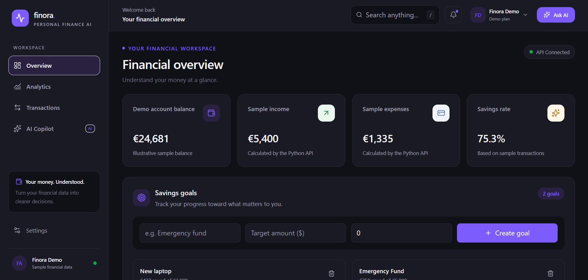
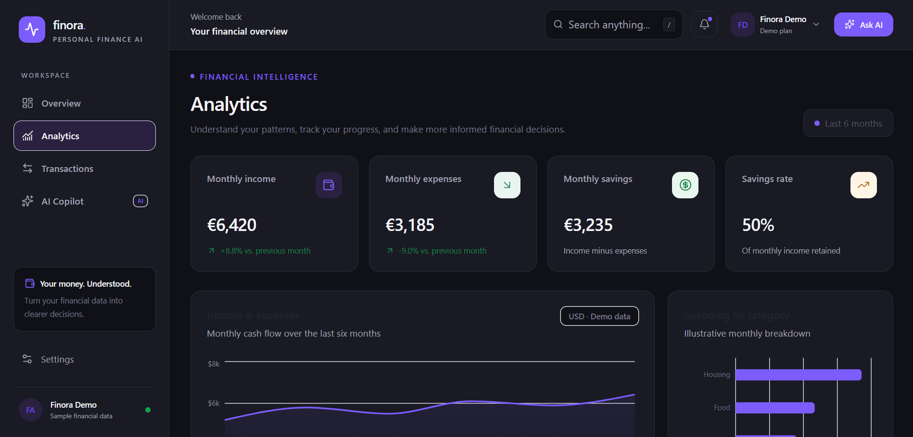
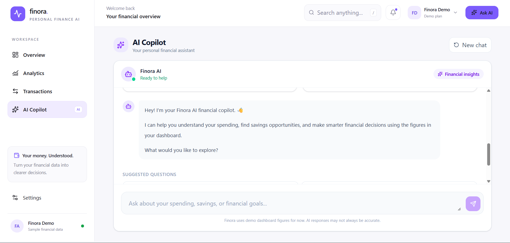
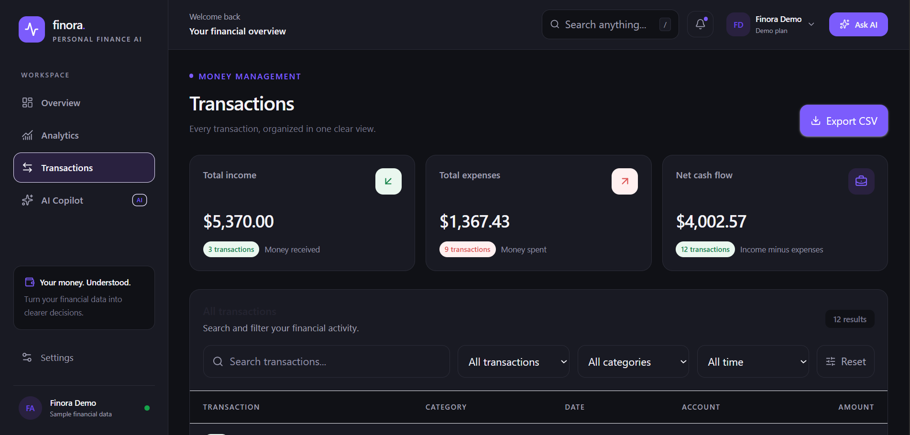

# Finora AI

### Your money. Understood.

Finora AI is an AI-powered financial intelligence platform that combines interactive financial analytics with an LLM-powered financial assistant.

Built to help users understand their financial activity through data visualization, spending analysis, and conversational AI.

## Application Screenshots

### Overview Dashboard


### Financial Analytics


### AI Financial Copilot


### Transaction Management


## Features

- **Financial Dashboard** – Overview of income, expenses, savings, and financial activity.
- **Financial Analytics** – Interactive charts and spending breakdowns to understand financial patterns.
- **AI Financial Copilot** – Conversational financial assistance powered by the Groq LLM API.
- **Transaction Management** – Explore and analyze financial transactions.
- **Savings Goals** – Create, update, and track savings goals with persistent SQLite storage.
- **Personalization** – Customizable currency formatting, light and dark themes, and persistent preferences.

## Tech Stack

| Layer | Technology |
|---|---|
| Frontend | React, TypeScript, Vite |
| Backend | Python, FastAPI |
| AI Integration | Groq API |
| Database | SQLite |
| Visualization | Recharts |

## Architecture

Finora AI uses a React frontend that communicates with a Python FastAPI backend through REST API endpoints.

The backend handles financial calculations, savings goal persistence, and AI requests to the Groq API.

## Getting Started

### Prerequisites

- Node.js and npm
- Python 3.10+
- A Groq API key

### 1. Clone the repository

```bash
git clone https://github.com/dhuro523/finora-ai.git
cd finora-ai
```

### 2. Set up the backend

```bash
cd backend
python -m venv .venv
```

Activate the environment.

**Windows PowerShell:**
```powershell
.\.venv\Scripts\Activate.ps1
```

**macOS / Linux:**
```bash
source .venv/bin/activate
```

Install dependencies:

```bash
pip install -r requirements.txt
```

Create a `.env` file inside the backend directory:

```env
GROQ_API_KEY=your_groq_api_key_here
```

Start the backend:

```bash
uvicorn main:app --reload
```

API documentation: http://127.0.0.1:8000/docs

### 3. Set up the frontend

Open a second terminal:

```bash
cd frontend
npm install
```

Create a `.env` file inside the frontend directory:

```env
VITE_API_BASE_URL=http://127.0.0.1:8000
```

Start the frontend:

```bash
npm run dev
```

Open the local URL provided by Vite, usually http://localhost:5173.

## Project Notes

- Financial dashboard transactions currently use demonstration data.
- Savings goals are stored persistently in a local SQLite database.
- AI functionality requires a valid Groq API key.
- Currency selection changes displayed currency formatting; it does not perform live exchange-rate conversion.

## License

To be determined.